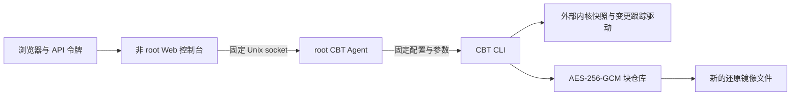

# 架构

Open Vault 由非 root Web 控制台、受限 root Agent、CBT CLI 和独立加密块仓库组成。Web 不直接访问源块设备、COW 文件或仓库密钥。

首次读取稳定快照形成全量基线；以后旋转快照边界，读取已关闭 COW 索引声明的变更区间。仓库通过父代重建完整镜像并计算 SHA-256；因此源读取减少不等于仓库端没有完整校验工作。镜像提交和 HEAD 持久性确认先于跟踪状态释放；源快照读取句柄必须先关闭。

只有已发布 HEAD 父链中的版本进入历史列表。恢复、校验和历史查询不需要原始驱动运行；恢复仅创建新文件。仓库格式、256 GiB 容量、128 代链及其他限制见 [CBT-USAGE.md](CBT-USAGE.md)。

Agent 只接受备份、校验、恢复和固定元数据查询，不接受命令、任意设备或外部 URL。执行记录保存到 Agent 私有状态目录。Web 只保存浏览器会话令牌，不持有备份配置或密钥。

当前没有旧文件备份执行引擎和目录任务调度器。真实内核支持以 [验证记录](CBT-VALIDATION.md) 为准。
