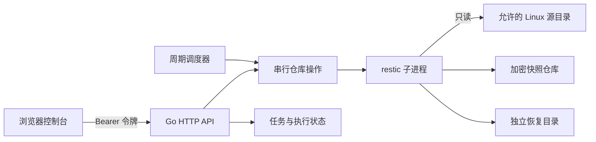

# 架构与首版边界

Open Vault 是 Linux 文件备份控制器。Go 标准库服务承载内嵌 Web 控制台、认证 API、任务状态和周期调度；restic 子进程完成仓库初始化、备份、快照查询、检查与恢复。服务通过配置文件选择一个本地仓库，首版不接受用户提供的任意远端仓库 URL。

源目录、仓库、状态和恢复目录应彼此独立。路径检查和文件权限共同限制可访问范围；控制器进程身份决定最终操作能力。建议使用专用用户，并将源挂载为只读。允许源目录中的符号链接和文件内容仍应视为受信任的主机输入，不应向不可信租户开放目录写入。

除活性探针外，API 使用 Bearer 令牌认证。单个令牌具有管理权限，首版没有细粒度授权。密码仅通过文件提供给 restic，服务需要能够读取该文件。HTTPS 应由反向代理提供。

仓库操作全局串行，目的是约束资源和仓库访问。任务按间隔调度，不提供分布式调度、集群故障转移或停机追补保证。长时间操作受到配置的超时约束；超时、源文件不可读或仓库空间耗尽都可能造成备份失败，必须结合执行记录处理。

restic 提供加密、去重和快照格式。Open Vault 的首版范围是任务编排和可视化，不包含块级系统镜像、Linux 引导修复、LVM 快照协调、数据库事务冻结或裸机恢复。恢复文件应先在独立目录检查，再由管理员按业务流程接管。
