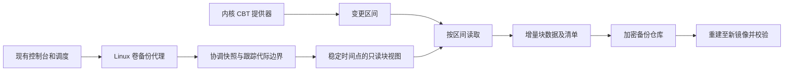

# V2：Linux 卷级 CBT 备份设计草案

状态：实验分支已实现用户态驱动适配、加密增量镜像及受限控制台代理；真实内核能力需通过隔离实验验收。V1 文件备份行为保留。操作与验证状态以 [实验命令](CBT-USAGE.md)、[Agent 部署](CBT-AGENT.md)和[内核实验](CBT-LAB.md)为准。

## 目标与现状

CBT 全称 Changed Block Tracking，记录备份周期之间被写入的逻辑块。它解决源端“该读取哪些块”的问题。内容分块去重解决“读取后有哪些内容已经保存”的问题，两者可以组合。

当前 Open Vault 调用 restic 进行文件备份。restic 可以复用未变化文件的数据并对读取内容去重，但本项目没有安装内核块跟踪器，不具备卷级 CBT。CBT 也不自动等于应用一致性、文件恢复或可启动的裸机恢复。

Synology 官方文档确认 Linux ABB 依赖随代理安装的快照驱动实施 CBT；本项目只能独立实现相同类别的能力，不声称复用或兼容其私有驱动和仓库格式。

## 路线比较

| 路线 | 适用环境 | 需要验证的条件 | 限制 |
| --- | --- | --- | --- |
| dattobd 类外置驱动 | 现有普通 Linux ext4/XFS 卷，候选路线 | 指定内核、发行版、驱动构建/加载、快照与跟踪切换语义、重启恢复 | 需要内核模块支持、权限及升级兼容测试，不能直接承诺支持所有内核 |
| dm-era + 协调快照 | 能预先配置 Device Mapper 数据路径的卷 | 目标内核模块、元数据设备、所有写入经过跟踪层、快照与 era 边界对应 | 需要部署或迁移设备映射；普通 LVM 快照本身不等于完整 CBT |
| Btrfs/ZFS 增量发送 | 已使用相应文件系统的用户 | 原生快照和增量复制能力 | 是存储原生增量路线，不能宣传为通用 ext4/XFS 块跟踪 |

推荐先针对一组明确的 Ubuntu 内核和 ext4 数据卷评估外置驱动，使用可销毁虚拟机及测试盘。若用户已有可控的 Device Mapper 存储布局，再选择 dm-era。最终选型依赖用户目标主机信息与实测。

## 新增的数据路径

控制台继续使用非特权身份。受限代理只操作管理员预配置的卷 ID，不允许浏览器任意指定块设备或运行命令。代理负责卷身份检查、能力探测和快照生命周期。

第一版验证目标是备份一个数据卷，并恢复为全新的普通镜像文件。写入真实磁盘、根分区在线保护和启动修复需要后续独立实现及验收。

## 正确性要求

1. 首次备份建立可验证的全量基线。之后只从对应快照读取追踪器报告的变更区间；不以扫描全盘哈希、文件时间戳或 inotify 冒充 CBT。
2. 追踪器代际切换和快照必须遵循所选提供器的正确协议，保证并发写入不会落入任何遗漏窗口。不能仅在“读完后清空位图”。
3. 备份清单记录卷稳定身份、逻辑大小、扇区及跟踪块大小、父备份 ID、跟踪器代际、快照边界、数据块偏移/长度/摘要。
4. 远端数据和清单持久提交成功后，才推进已提交的备份基线。失败重试必须继续覆盖该期间的所有变更。
5. 追踪器断开、重启后状态无法确认、位图溢出、卷身份或大小改变、代际回退等情况，必须中止增量并要求重新建立全量基线。
6. discard/TRIM、清零、尾块及设备扩容必须有明确语义及实测。不能仅复制普通 WRITE 数据而默默保留旧版本中应清零的区间。
7. 崩溃一致性与应用一致性分别标注。文件系统冻结与快照可以帮助取得稳定边界；数据库仍需要应用协调、日志或专用备份方法。

## restic 是否保留

可以保留 V1 的文件备份引擎。V2 也可评估将“增量块包 + 镜像清单”作为普通文件交给 restic 存储，复用其加密与仓库机制；这需要新增块清单、父版本管理和镜像重建协议，restic 的普通文件恢复不能直接完成卷恢复。

把整个块设备通过 stdin 重新交给 restic，或每次重新生成完整镜像再备份，不能证明源端只读了变更块。验收需要实际读取字节数等指标。

## 验收门槛

- 隔离虚拟机：全量 → 精确修改已知块 → 增量 → 重建镜像，与同期稳定快照逐字节或摘要比对。
- 记录变更区间数、源端实际读取量和上传量，验证读取量随变更区间及必要元数据增长。
- 验证备份期间持续写入、进程被杀、网络中断、主机重启、COW 空间耗尽、跟踪状态丢失和备份链缺失。
- 验证文件创建/删除、文件系统元数据、TRIM/清零和多版本恢复；镜像文件通过文件系统检查后才能继续评估挂载浏览。
- 驱动构建成功、模拟位图测试成功或 WSL 用户态测试成功，都不能替代实际内核数据路径验证。

## 开发前需要的环境信息

发行版与完整内核版本、目标架构、Secure Boot 状态、文件系统、LVM/Device Mapper 布局，以及可销毁虚拟机和测试盘的可用性。当前会话只验证过 WSL 内的用户态文件备份，不具备已验证的 CBT 驱动运行环境。

## 依据

- [Synology Linux ABB 限制与快照驱动 CBT](https://kb.synology.com/en-uk/UG/Synology_ABB_admin_guide_Linux/3)
- [Synology Agent 的 Linux 内核模块与 CBT 说明](https://kb.synology.com/en-sg/DSM/help/ActiveBackupBusinessAgent/activebackupbusinessagent?version=7)
- [Linux 内核 dm-era 文档](https://docs.kernel.org/admin-guide/device-mapper/era.html)
- [Linux 内核 Device Mapper snapshot 文档](https://docs.kernel.org/admin-guide/device-mapper/snapshot.html)
- [Datto dattobd 源项目](https://github.com/datto/dattobd)
- [restic 备份文档](https://restic.readthedocs.io/en/stable/040_backup.html)
